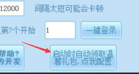

# 批量领取温馨礼包

## 一、如何自动领取



打开桌面版主程序，点击右下角的 **「温馨礼包」**，进入设置界面。

只需要完成以下 3 步：

1. 将温馨礼包链接粘贴到输入框。
2. **每行填写一个完整链接，不要填写任何其他内容。**
3. 点击 **「保存」**，保存成功后才会生效！

### 正确填写示例

```text
http://meishi.wechat.123u.com/meishi/index?openid=abc123
http://meishi.wechat.123u.com/meishi/index?openid=abc456
http://meishi.wechat.123u.com/meishi/index?openid=abc789
```

### 错误填写示例

```text
#http://meishi.wechat.123u.com/meishi/index?openid=abc123
账号2：http://meishi.wechat.123u.com/meishi/index?openid=abc456
```

**错误原因：** 不要添加账号名称、序号、备注、引号或其他字符。每行只能有一个链接。

> **重要：粘贴完成后必须点击「保存」！**
>
> 特别是 Windows 11 用户，关闭窗口不等于保存。请确认已经保存成功。

**小技巧：** 可以和熟人交换温馨礼包链接，互相帮忙领取，避免忘记开电脑而漏领。

---

## 二、如何给小号绑定温馨礼包

**不需要多个微信号，也可以给多个小号分别绑定温馨礼包。**

### 第一步：生成绑定链接

基础链接：

http://meishi.wechat.123u.com/meishi/index?openid=

在链接末尾的 `openid=` 后面添加一段自定义的数字或字母即可。

例如：

- 4399账号：114514
- 所在服务器：88服
- 推荐填写：`114514_88`

得到完整链接：

http://meishi.wechat.123u.com/meishi/index?openid=114514_88

**注意：** `114514_88` 仅作为示例，你可以自行修改。推荐使用账号和服务器编号组合，方便以后找回。

### 第二步：手动完成绑定

1. 复制刚才生成的完整链接。
2. 在浏览器中打开。
3. 按照网页提示，**手动完成温馨礼包绑定**。

**注意：生成链接不等于已经绑定成功，必须在网页中完成绑定操作。**

### 第三步：设置自动领取

绑定成功后，将刚才的完整链接粘贴到桌面版的温馨礼包设置中，最后点击 **「保存」**。

以后就可以使用桌面版自动领取了。(每次启动桌面版时自动领取)

---

## 三、其他自动化功能

**1. 自动绑定温馨礼包**

- [自动绑定与自动领取说明](./auto_fight_list.md#bind-warm-gift)
- [使用批量自定义战斗完成绑定](./auto_fight_list.md#批量自动化-自定义战斗)
- 新版本也可以使用批量窗口中的「任务事项」选项卡。

**2. 自动开启温馨礼包**

在「批量日常」中勾选 **「开十三香礼包」**，会自动开启所有同类礼包，包括温馨礼包。

**3. 自动开启双爆**

请参阅「批量自动挂机」相关说明。

---

## 四、自动领取失败？先检查这里！

遇到无法领取的问题，请依次检查：

- [ ] **是否点击了「保存」？** 仅仅粘贴链接是不够的。
- [ ] **是否每行只有一个完整链接？** 不能添加账号、备注、序号或其他内容。
- [ ] **是否已在浏览器中完成绑定？** 仅仅生成链接并不代表绑定成功。
- [ ] **链接是否完整？** 请确认复制时没有漏掉任何内容。

**最常见的两个问题：没有保存、链接格式填写错误。请优先检查这两项。**